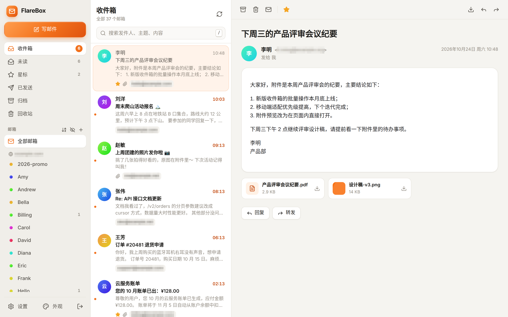
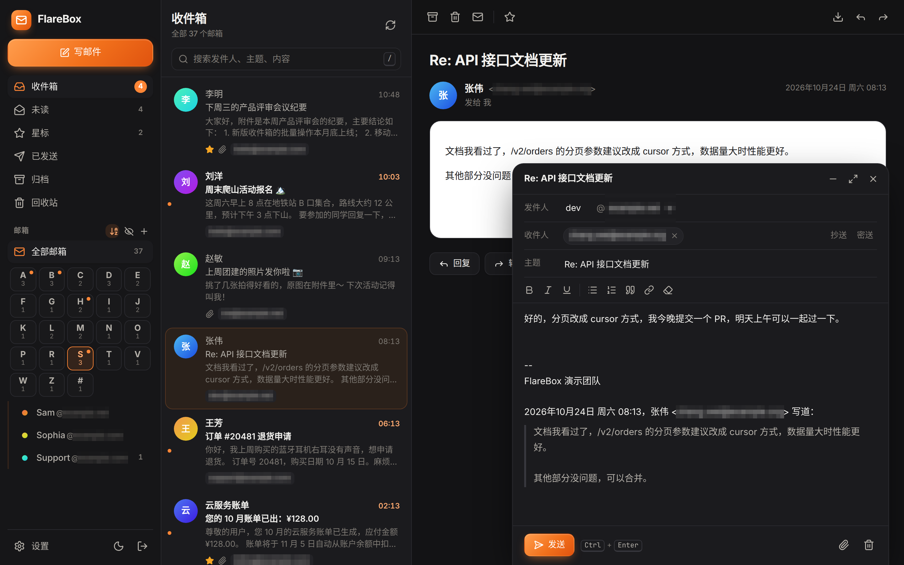
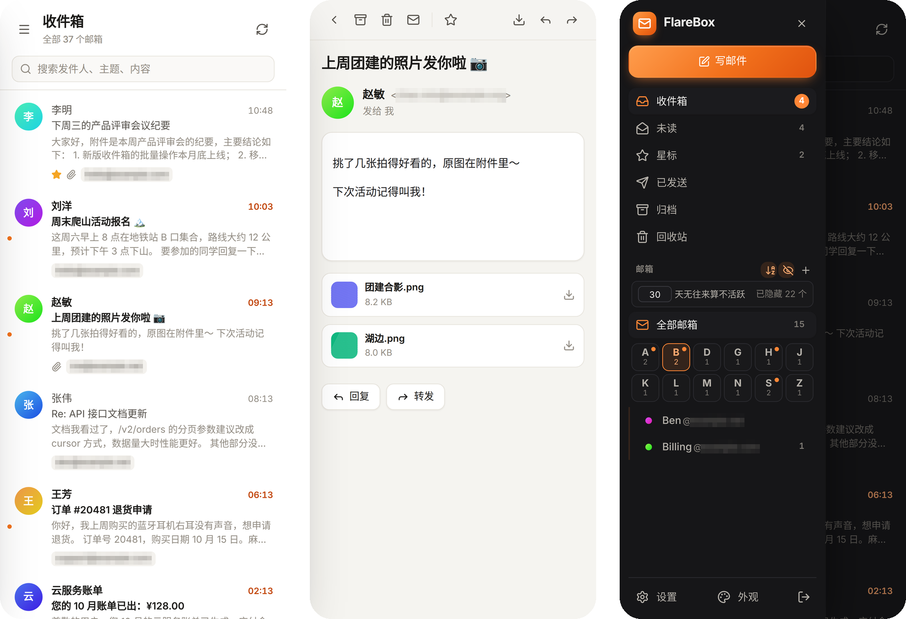

# FlareBox · 自有域名邮箱

把你在 Cloudflare 上的域名变成真正能**收、发**邮件的邮箱：一个网页统一管理所有域名、所有地址。
完全跑在你自己的 Cloudflare 账户里，不需要服务器：Workers 负责收发和网页，D1 存邮件，（可选）R2 存附件。

[](https://deploy.workers.cloudflare.com/?url=https://github.com/erha-erha/flarebox)



<details open>
<summary>深色主题、手机端</summary>





</details>

> 截图为本地演示数据，邮箱地址和域名已打码。

## 特性

- **一键接入域名**：连接 Cloudflare 后，在列表里点一下，自动完成 MX / SPF / DKIM、Catch-all 收信路由、发信域名开通
- **任意地址即用**：发往 `*@你的域名` 的邮件自动收下并创建邮箱；也可以直接用任意地址发信
- **完整收发**：HTML 邮件、附件、内嵌图片、回复 / 全部回复 / 转发（带附件）、抄送密送、签名；发件人前缀可手动输入，域名下拉选择
- **邮箱多也好找**：几十上百个邮箱时可按 A–Z 字母分组（默认收起，点字母展开）；可隐藏 N 天无往来的不活跃邮箱，天数自定义
- **精美界面**：三栏式邮件客户端，深色 / 浅色主题，左下角「外观」可切换背景图片（内置山川、湖海、日月星辰、森林原野 24 张风景照片和 6 张插画，也可上传本地图片或填写图片链接，毛玻璃透明度可调），手机自适应，快捷键（`C` 写信、`/` 搜索、`J`/`K` 切换、`E` 归档、`R` 回复）
- **隐私安全**：邮件 HTML 在沙箱中渲染并剔除脚本，默认拦截远程追踪图片；黑名单拒收；登录限流
- **两种发信方式**：Cloudflare Email Service 原生发信，或 Resend
- **零运维**：首次访问自动建表，无需手动执行数据库迁移；回收站 30 天自动清理

## 部署

### 方式一：Deploy 按钮

点击上方 **Deploy to Cloudflare**，按提示授权 GitHub 和 Cloudflare。部署时会提示填写 `ADMIN_PASSWORD`（管理员密码）。
D1 数据库会自动创建。部署完成后打开 Worker 地址，用该密码登录。

### 方式二：一条命令

需要 Node.js 20+。

```bash
git clone https://github.com/erha-erha/flarebox.git
cd flarebox
npm install
npm run setup -- --domain mail.example.com
```

脚本会：

1. 打开 Cloudflare 授权（在远程服务器 / SSH 上会自动使用设备码授权，在任何设备的浏览器里确认即可）
2. 构建并部署 Worker，自动创建 D1 数据库，绑定自定义域名（`--domain` 可省略，省略时使用 `workers.dev` 地址）
3. 输出一个带**一次性安装码**的链接，打开后设置管理员密码。安装码防止别人抢先占用刚上线的站点

## 接入邮箱域名

登录后进入 **设置 → 域名**：

1. 点击「打开 Cloudflare 授权页」，Cloudflare 会打开已预填权限的 API 令牌页面，创建并复制令牌
2. 粘贴令牌，FlareBox 会列出你账户下的所有域名
3. 在要使用的域名旁点 **一键接入**

> ⚠️ 一键接入会把该域名的 Catch-all 规则指向 FlareBox。如果这个域名正在用其它邮箱服务或其它 Worker 收信，收信会被切换过来。界面会显示当前的 Catch-all 目标，确认后再接入。

令牌所需权限：区域 Zone 读取、区域设置 Zone Settings 编辑、DNS 编辑、电子邮件路由规则 Email Routing Rules 编辑、（可选）电子邮件发送 Email Sending 编辑。
如果预填链接没有勾上某项权限，手动添加即可。

不想授权令牌？可以在 Cloudflare 控制台的 Email Routing 中把 Catch-all 设为「发送到 Worker：flarebox」，再在「设置 → 域名 → 高级」中手动添加域名。

## 发信

| 方式 | 条件 | 说明 |
| --- | --- | --- |
| Cloudflare Email Service（默认） | Workers 付费计划（$5/月） | 一键接入时自动开通发信域名并添加 SPF / DKIM / DMARC。未开通前只能发给已验证的目标地址 |
| Resend | Resend 账号（免费 3000 封/月） | 在 resend.com 验证域名，把 API Key 填到「设置 → 发信」 |

## 存储

- 默认把附件和原始邮件分块存放在 D1，无需开通 R2
- 开通 R2 后，在 `wrangler.jsonc` 中取消 `r2_buckets` 那一行的注释并重新部署，新邮件会改存 R2（容量更大、成本更低）

## 本地开发

```bash
npm install
npm run dev
```

本地会模拟 D1 和发信（邮件内容写入 `.wrangler/tmp/email`，不会真的发出）。模拟收到一封邮件：

```bash
curl -X POST 'http://localhost:5173/cdn-cgi/local/email?from=a@example.org&to=hello@your.domain' \
  --data-binary $'From: a@example.org\r\nTo: hello@your.domain\r\nSubject: Hi\r\nMessage-ID: <1@example.org>\r\n\r\nHello'
```

（需要先在「设置 → 域名 → 高级」手动添加 `your.domain`。）

## 项目结构

```
worker/            Cloudflare Worker（Hono）
  index.ts         HTTP API、email() 收信入口、定时清理
  inbound.ts       解析收到的邮件（postal-mime）并入库
  send.ts          发信（Cloudflare Email Service / Resend）
  cloudflare.ts    一键接入域名：Email Routing、Catch-all、发信域名
  storage.ts       附件存储（R2 或 D1 分块）
  db.ts            D1 表结构（运行时自动创建）
  auth.ts          登录、会话、限流
src/               React 前端
scripts/setup.mjs  一键部署脚本
```

## 限制

- Cloudflare Email Routing 单封入站邮件上限 25 MB；Email Service 发信上限 5 MB（含附件）
- Workers 免费计划每次请求的 CPU 时间很短，解析特别大的邮件可能超时，建议使用 Workers 付费计划
- 目前是单管理员模式：一个密码管理所有域名和邮箱
- 不提供 IMAP / SMTP，请使用网页客户端（已适配手机浏览器）
